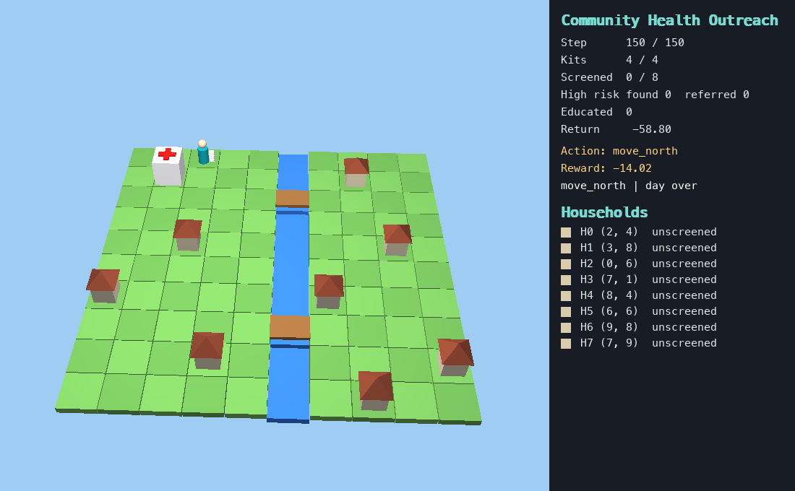

# Community Health Outreach: RL mission (DQN vs REINFORCE vs PPO vs A2C)

A custom Gymnasium environment based on my capstone mission, **community-level screening for
non-communicable diseases (hypertension and diabetes)**. A Community Health Worker (CHW) agent
spends one field day covering a rural district. It visits households, screens residents with a
limited stock of test kits, refers high-risk people to the health centre, gives health education
to low-risk households, and goes back to the clinic to restock. Four RL algorithms are trained on
the same environment with [TorchRL](https://docs.pytorch.org/rl/stable/index.html) and compared.



## Quick start (uv only)

```bash
git clone <repo-url> student_name_rl_summative && cd student_name_rl_summative
uv sync
uv run main.py                      # best trained agent, 3D OpenGL window + verbose terminal log
```

Other entry points:

```bash
uv run main.py --algo ppo --episodes 5      # a specific agent: dqn | reinforce | ppo | a2c
uv run main.py --algo random                # untrained random agent (environment demo)
uv run main.py --compare                    # evaluate all four best models on 100 unseen days
uv run main.py --renderer 2d                # top-down pygame view if OpenGL is unavailable
uv run main.py --algo a2c --gif assets/best_agent.gif   # record a GIF instead of a window

uv run python -m training.dqn_training                  # train one DQN with the default config
uv run python -m training.pg_training --algo ppo        # train one PPO / A2C / REINFORCE
uv run python -m training.sweep --algo all --workers 6  # the 10-run sweep per algorithm (40 runs)
uv run python -m training.plots                         # figures in assets/, tables in logs/
uv run pytest                                           # environment unit tests
```

## Environment

| Item | Definition |
|---|---|
| Map | 10×10 district split by a river (x = 5) that can only be crossed at two bridges (y = 2, y = 7). Clinic at (1, 1); 8 households at fixed positions. |
| Hidden state | Each household's risk (high with p = 0.4, at least one per day) is re-drawn every episode and only revealed by screening. |
| **Actions** (Discrete 8) | `0 move_north`, `1 move_south`, `2 move_west`, `3 move_east`, `4 screen_household` (uses 1 kit), `5 refer_to_clinic`, `6 restock_kits` (at clinic), `7 health_education` |
| **Observation** (Box 61, [-1, 1]) | position, kits/5, time left, at-clinic, on-household; 4-d route hint (next step toward nearest outstanding task, the CHW's phone map); 3 "task here" flags; for each of 8 households: relative dx, dy, screened, known-high-risk, referred, educated |
| **Start state** | Agent at the clinic with 5 kits, t = 0, all households unscreened. |
| **Terminal** | *Success*: every household screened and every high-risk resident referred. *Truncation*: 200 steps (end of the working day). |

**Rewards**

| Event | Reward |
|---|---|
| each step (time cost) | −0.02 |
| screen a new household | +2 (+1 more if high risk is detected) |
| refer a screened high-risk resident | +5 |
| health education for a screened low-risk household | +1 |
| restock when out of kits | +0.5 |
| invalid action (screen/refer/educate/restock where not applicable) | −0.5 |
| walk into the river or off the map | −0.3 |
| potential-based shaping | 0.1 × (change in −distance to the nearest outstanding task) |
| mission complete | +10 + 5 × fraction of the day left |
| day ends early | −2 per unreferred high-risk resident, −1 per unscreened household |

## Visualisation

`environment/rendering.py` draws a lit, shaded 3D scene with **PyOpenGL** in a pygame window: the
river and bridges, the clinic with its red cross, households coloured by status (beige =
unscreened, red + pulsing beacon = high risk not yet referred, purple = referred, green = low
risk, yellow = educated), and the CHW carrying a stack of test kits. A HUD panel shows step,
kits, return, the last action and reward, and each household's status. A 2D pygame renderer is
the fallback when no OpenGL context exists.

## Algorithms (all TorchRL)

* **DQN**: `QValueActor`, `EGreedyModule`, `Collector`, `ReplayBuffer`, `DQNLoss` (double DQN,
  n-step targets through `MultiStep`), `HardUpdate`/`SoftUpdate` target networks.
* **REINFORCE**: `ProbabilisticActor` (categorical), Monte-Carlo returns-to-go, `ReinforceLoss`,
  optional learned value baseline.
* **PPO**: `ClipPPOLoss` + `GAE`, minibatch epochs over each rollout.
* **A2C**: `A2CLoss` + `GAE` (λ = 1 → n-step advantage), short rollouts, RMSprop.

Each algorithm has 10 hyperparameter configurations (`SWEEP` / `SWEEPS` in `training/`). Per-run
curves go to `logs/<algo>/run_XX.csv`, per-run summaries to `logs/<algo>_sweep.csv`, and the best
model per algorithm to `models/dqn/dqn_best.pt` and `models/pg/<algo>_best.pt`.

## Layout

```
environment/custom_env.py   Gymnasium env (actions, observations, rewards, termination)
environment/rendering.py    PyOpenGL 3D renderer + 2D fallback
training/common.py          TorchRL env wrapper, networks, evaluation, logging
training/dqn_training.py    DQN
training/pg_training.py     REINFORCE, PPO, A2C
training/sweep.py           parallel hyperparameter sweeps + best-model selection
training/plots.py           report figures and tables
main.py                     run / visualise / compare trained agents
models/  logs/  assets/  tests/
```
